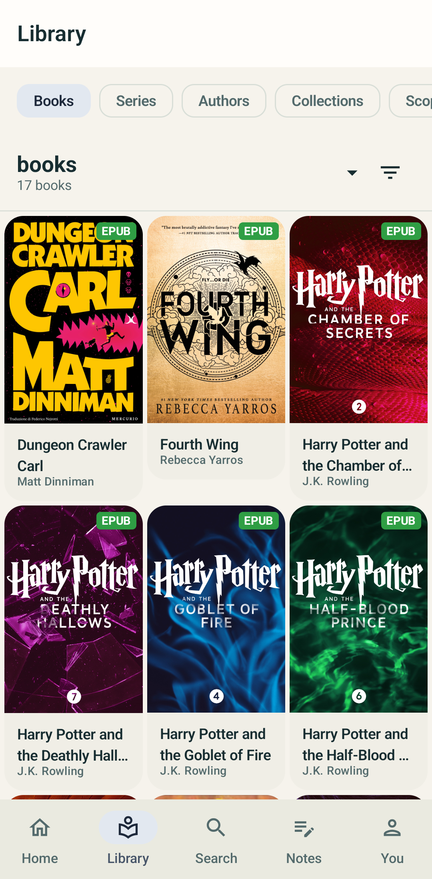
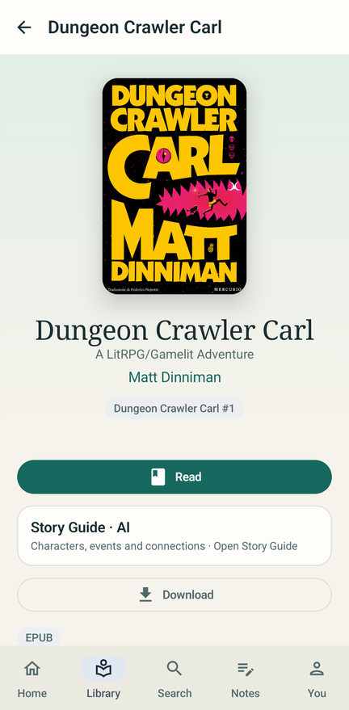
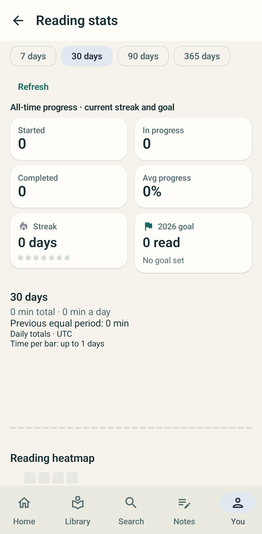

<div align="center">
  
  <h1>BookOrbit Client</h1>
  <p>Read EPUBs and manga, or listen to audiobooks from your BookOrbit server.</p>
  <p>An independent, open-source Android client for self-hosted BookOrbit.</p>
  <p>
    <a href="LICENSE"></a>
    
    
  </p>
  <p>
    <a href="#what-it-does">Features</a> ·
    <a href="#build--install">Build</a> ·
    <a href="#allow-this-client-on-your-own-server">Server setup</a> ·
    <a href="ROADMAP.md">Roadmap</a> ·
    <a href="docs/DEVICE_TESTING.md">Testing</a>
  </p>
</div>

> This is an independent fork of
> [deranjer/bookorbit-android](https://github.com/deranjer/bookorbit-android), with
> upstream attribution and the AGPL license preserved. It is not the official
> BookOrbit app. The fork adds no client-side Premium gates or download quotas,
> and does not automatically download your whole library.

## What it does

<div align="center">
  
  &nbsp;&nbsp;
  
  &nbsp;&nbsp;
  
  <br>
  
  &nbsp;&nbsp;
  
  <p><sub>0.9.23 · English UI · self-hosted library, shown with the server owner's permission. Book text and artwork belong to their respective rights holders.</sub></p>
  <p><sub>Statistics show the account's empty history before the reading session. EPUB pagination depends on the font and screen size.</sub></p>
</div>

| | Features |
| --- | --- |
| **Read** | Native EPUB-family, PDF and comic readers; text settings, themes, bookmarks, highlights and notes. Opt-in on-demand EPUB chapters/resources. |
| **Listen** | Media3 background audiobooks, HTTP Range streaming, multi-track queues, sleep timer and Android media controls. Source-built software audio decoding with platform-first fallback. |
| **Read along** | Embedded EPUB/SMIL narration through the shared playback service, online or explicitly offline. Exact fragment highlighting, audio checkpoints and **Listen from here** in selection → ⋮. |
| **Keep offline** | Download text, audio or both. |
| **Look up words** | Downloadable FreeDict dictionaries: **305 catalog pairs**, searchable language chooser and private offline indexes. Dictionaries download only when requested. |
| **Use AI** | Server Reading Help, photo search and Story Guide clients. Direct selected-text help with OpenAI, Gemini, OpenRouter, Ollama and OpenAI-compatible endpoints. |
| **Track reading** | 7/30/90/365-day periods, previous-period comparison, compact calendar and weekly session history without inventing READ/LISTEN distinctions. |
| **Troubleshoot** | Optional private debug logging, bounded local storage and explicit text-file export. No automatic log upload. |

Version 0.9.23 includes diagnostic logging. Both debug APK builds and lint tasks
passed, along with 627 JVM tests per flavor, 34 Node checks (including three policy
checks) and 14 Python checks. Two diagnostic instrumentation tests passed in each
of three runs; log export through Android's file picker was checked on the emulator.
Feature parity and physical-device testing are incomplete. The
[validation checklist](docs/DEVICE_TESTING.md) records the tested scenarios and
remaining checks.

For server requirements and unfinished work, see the
[detailed plan](docs/CLIENT_PLAN.md), [AI compatibility](docs/AI_COMPATIBILITY.md)
and [audio compatibility](docs/AUDIO_COMPATIBILITY.md).

## Connect your server

1. Enter your BookOrbit URL and sign in with your existing account.
2. For OIDC, allow **`bookorbitclient://oauth2-callback`** in the server's
   `OIDC_MOBILE_REDIRECT_URIS`. Do not use the official app's callback for this fork.
3. Choose a reader mode in **Settings → Reading**. Cached-file mode is the default;
   online EPUB mode loads resources on demand. Explicit offline editions take priority.

Use HTTPS for remote deployments. Plain HTTP is supported for trusted local BookOrbit
connections, but **device-key enrollment requires HTTPS**. Development against the
isolated fixture server is described in [tools/README.md](tools/README.md).

### AI entry points

- **Settings → AI connection:** choose BookOrbit server or a direct provider;
  saving does not make a billable model call.
- **Reader selection → Reading Help:** explicitly confirm sending the selected text.
- **Search → Find by photo · AI:** choose a cover/shelf photo, review it and confirm.
  This currently uses BookOrbit's server configuration, not the direct-provider key.
- **Book details → Story Guide · AI:** open the card below Read/Listen. Opening
  reads status/content; creating or updating a guide is a separate confirmed job.

Server Reading Help, photo search and Story Guide need
[server trust setup](#allow-this-client-on-your-own-server). Direct selected-text
help uses your provider connection instead.

Direct credentials stay encrypted and scoped to the server/account/provider.
Changing a custom endpoint drops its previous token. Custom HTTP endpoints require
explicit opt-in. There is no automatic provider/route fallback or paid POST replay.

## Allow this client on your own server

This setup is for **server Reading Help, photo search and Story Guide**, which use
BookOrbit's protected AI routes. Ordinary library browsing and direct-provider
selected-text help do not need it.

This removes the **official-app-only identity restriction for one explicitly trusted
build**, not all authentication or device-security checks. It is intended only for
servers you administer. There is no stock admin field where you can paste this key.

The audited policy is in
[`server/src/modules/app-attest/app-attest.policy.ts`](https://github.com/bookorbit/bookorbit/blob/v3.9.0/server/src/modules/app-attest/app-attest.policy.ts).
It hardcodes permitted package/signing-certificate pairs. Adding a phone key directly,
an ordinary API key, or an environment variable to an unmodified server is not equivalent.

### 1. Identify the APK you actually installed

Use Android SDK tools against that exact artifact:

```sh
apkanalyzer manifest application-id /path/to/client.apk
apksigner verify --print-certs /path/to/client.apk
```

You need the **package ID** and **Signer certificate SHA-256 digest**, not the APK
file's SHA-256, a phone public-key hash or an AI token. A locally rebuilt debug APK
usually has a different signing certificate.

For the locally validated 0.9.22/0.9.23 development artifacts, the expected pair is:

```text
package: io.github.monkecode.bookorbitclient.debug
certificate SHA-256:
9f8472c84b54b5033314fb3cd26ac949a2b7d818a78530263c3e8dc955c64f0d
```

**Verify your artifact; do not trust this example blindly.** Prefer a stable private
release-signing key for a friends-and-family deployment. Never upload that private key.

### 2. Add the exact pair in a separate server source checkout

Back up your database and deployment configuration first. Work from the **same server
version you run**, not a random newer branch, and do not edit a live container.
The provided minimal patch was tested on **BookOrbit v3.9.0**, commit
`c1dd6b4f1947ff50843a155e12e70f1e7d15f0c7`; other versions need review.

Inside `androidKeyAttestPolicy()`, add an entry to `apps`, retaining the official entries:

```ts
{
  packageName: 'io.github.monkecode.bookorbitclient.debug',
  signatureDigests: [
    '9f8472c84b54b5033314fb3cd26ac949a2b7d818a78530263c3e8dc955c64f0d',
  ],
  development: false,
},
```

Use your own verified values when they differ. `development: false` is intentional:
even an APK whose package ends in `.debug` must pass the normal hardware checks.

For that **exact example pair and v3.9.0 only**, this repository also supplies
[`minimal-debug-apk-policy.patch`](tools/server-compat/minimal-debug-apk-policy.patch).
From the separate server checkout:

```sh
# Set CLIENT_REPO to the absolute path of this Android repository.
git apply --check "$CLIENT_REPO/tools/server-compat/minimal-debug-apk-policy.patch"
git apply "$CLIENT_REPO/tools/server-compat/minimal-debug-apk-policy.patch"
```

Do not add the digest under the official package name. Do not use `any`, disable
certificate validation, or set `NODE_ENV=development` as a workaround. Keep Google
trust roots, hardware/verified-boot checks, JWT/library permissions and replay protection.

### 3. Test, rebuild and deploy your custom server

The upstream policy test asserts exactly one production identity. Extend its expected
array with the same explicit entry rather than removing the test. Then, using the
server repository's required Node/pnpm versions:

```sh
pnpm install --frozen-lockfile
pnpm --filter server exec vitest run src/modules/app-attest
pnpm --filter server build

# Optional Docker artifact, built from the complete server source checkout.
docker build --build-arg APP_VERSION=3.9.0-local-client \
  -t bookorbit-with-client:3.9.0 .
```

Deploy the resulting image using your existing deployment's application service,
preserving volumes, secrets and production settings. Service names vary; there is
deliberately no blind `compose down` or database-reset command here. Retain a rollback
image. Future upstream image updates will not automatically contain your change.

An alternative [opt-in configurable policy](tools/server-compat/README.md) is available
if you maintain multiple exact package/certificate pairs. Its environment variable
works **only after applying that companion change**.

### 4. Register the phone, then check the feature

In the app, open **Settings → Device verification for AI → Register device key** and
confirm certificate disclosure. The phone creates its own hardware-backed key and
registers it for this server/account. You never paste its private key anywhere.

**Two separate steps are required:** the administrator first allows the APK's
exact package/signing-certificate pair on the server (steps 1–3); the user then
presses **Register device key** on a physical Android phone. The button performs
device-key enrollment, but does not add the APK to the server's trusted-app list.
You do **not** embed a device key or any additional shared secret in the APK, and
the APK's private signing key must never be included in the application.

After both steps succeed, test the protected feature with an authorized account
and a configured provider. This is the expected integration path, not a guarantee
that every device or AI operation will work. Existing Story Guide viewing also
requires server access in this version; persistent offline graph viewing is not
implemented yet.

If it fails, enable [debug logging](#debug-logging), reproduce once and save the log.
The UI reports the failing stage, HTTP status and a bounded `APP_ATTEST_*` code.
Use your server logs to distinguish app identity, certificate trust, device/boot,
clock, proxy and authorization failures. An unlocked or unsupported phone can still fail.

**What has actually been tested:** on an isolated v3.9.0 checkout, 109 attestation
tests and the server build passed. Synthetic enrollment/signature tests accept our
exact identity only after adding it and still reject wrong identities, roots,
challenges, software keys, body changes and replay. This is **not** real-phone
enrollment or end-to-end photo/model acceptance. No production deployment was changed.
The isolated tests used synthetic attestation certificates; they did not demonstrate
successful enrollment by a real phone pressing the registration button. During the
later authorized real-server screenshot session, login/library browsing succeeded,
but Story Guide returned an access restriction. The complete allowlist → physical
phone registration → protected-feature scenario on that deployment remains unverified.

The shared identity policy covers routes using that guard, but enabling trust does
not configure a model, grant account permissions, remove provider budgets, or
implement missing client features.

## Development

### Build & install

#### Docker

From this repository's root:

```sh
bash tools/android/gradle.sh :app:assembleFdroidDebug
```

APK: `app/build/outputs/apk/fdroid/debug/app-fdroid-debug.apk`.

```sh
# Optional: build with Google's Cast SDK.
bash tools/android/gradle.sh :app:assembleFullDebug

# Install on a device you explicitly selected with adb.
adb -s DEVICE_SERIAL install -r app/build/outputs/apk/fdroid/debug/app-fdroid-debug.apk
```

| Variant | Cast SDK | Debug installation ID |
| --- | --- | --- |
| `fdroid` | Excluded | `io.github.monkecode.bookorbitclient.debug` |
| `full` | Included | `io.github.monkecode.bookorbitclient.debug` |

The flavors replace one another, but do not replace the official or upstream app.
Release builds use `io.github.monkecode.bookorbitclient` and require your own
release-signing configuration. Debug APKs are for development; no new public binary
release is implied by a source push. Ignored `.local/apks/` archives are not GitHub
downloads and do not ship signing keys.

**Android Studio:** open this repository root. Minimum Android API is 26, target
API is 36, and the current Compose toolchain requires compile SDK 37.2. The pinned
Docker workflow is the reference build environment. More setup, fixtures and
emulator commands: [Local development](tools/README.md).

### Debug logging

Enable **Settings → About → Debug logging**, reproduce the issue, then choose
**Save logs**. Logging is off by default, stays on the device and excludes credentials
and book contents. Review the exported file before sharing it.

| Documentation | Purpose |
| --- | --- |
| [Roadmap](ROADMAP.md) | Short status and next priorities |
| [Client plan](docs/CLIENT_PLAN.md) | Detailed requirements, invariants and remaining work |
| [Device testing](docs/DEVICE_TESTING.md) | Acceptance checklist and evidence boundaries |
| [Local development](tools/README.md) | Docker builds, fixture server and emulator |
| [AI compatibility](docs/AI_COMPATIBILITY.md) | Audited server contracts and attestation |
| [Audio compatibility](docs/AUDIO_COMPATIBILITY.md) | Direct play, decoder fallback and transcoding limits |

## Attribution & license

This fork builds on [deranjer/bookorbit-android](https://github.com/deranjer/bookorbit-android).
The server is [bookorbit/bookorbit](https://github.com/bookorbit/bookorbit). Neither
project's official distribution channel is a release channel for this fork.

The client retains the [GNU AGPL v3 license](LICENSE). Preserve upstream copyright
and attribution notices. Reader, OCR, media and dictionary components retain their
own notices/licenses; FreeDict packages do **not** all share one data license.
Historical upstream context is retained in the [archived README](docs/history/README.before-refresh.md)
and [upstream roadmap](docs/history/UPSTREAM_ROADMAP.md).
